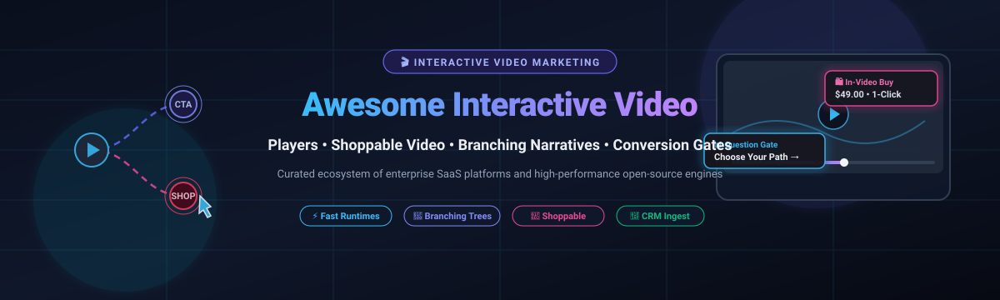

# 🎬 Awesome Interactive Video Marketing

  
  
  
  
  

  <strong>⚡ A curated directory of leading SaaS platforms, open-source interactive video players, branching video software, shoppable video tools, and engagement frameworks for modern video marketing. ⚡</strong>

Interactive video marketing transforms passive viewers into active participants by embedding clickable hotspots, branching decision trees, in-video lead capture forms, quizzes, and shoppable product overlays directly into video streams to radically improve engagement, retention, and conversion rates.

---

## 📑 Table of Contents

- [📊 Sector Overview & Market Dynamics](#-sector-overview--market-dynamics)
- [🏢 SaaS & Hosted Platforms](#-saas--hosted-platforms)
- [💻 Open-Source GitHub Projects](#-open-source-github-projects)
- [🧩 Feature Comparison Matrix](#-feature-comparison-matrix)
- [🎯 Key Selection Criteria](#-key-selection-criteria)
- [🤝 Support & Sponsoring](#-support--sponsoring)
- [🌟 Star History](#-star-history)
- [🛠️ How to Contribute](#️-how-to-contribute)
- [📜 Disclaimer & License](#-disclaimer--license)

---

## 📊 Sector Overview & Market Dynamics

The global interactive video and interactive media market is estimated at **$39.6B to $47.9B in 2025** (with the broader interactive streaming segment projected to exceed **$126B by 2030** at a rapid **CAGR of ~24.9%–26.1%**). 

The sector exhibits **moderate fragmentation with specialized tier concentration**: enterprise marketing and video hosting are anchored by multi-billion-dollar incumbents (HubSpot, Vimeo/Bending Spoons, Wistia, Vidyard), while shoppable video, interactive branching, and conversational video capture remain highly competitive and fragmented among agile niche players (Tolstoy, Mindstamp, VideoAsk). Concurrently, open-source solutions dominate educational interactivity (H5P, OVAL) and web runtime rendering (Aval, Liqvid), but commercial SaaS continues to capture the majority of high-conversion marketing and CRM-integrated funnels.

---

## 🏢 SaaS & Hosted Platforms

The table below ranks prominent commercial interactive video platforms by company scale (valuation or annual revenue), detailing transparent pricing and free tier/trial boundaries.

| 🏷️ Platform | 💰 Valuation / Company Scale | 💳 Starting Tier Price | 🎁 Free Tier Limits / Free Trial Policy | ✨ Key Interactive Marketing Capabilities |
| :--- | :--- | :--- | :--- | :--- |
| **[HubSpot Video](https://www.hubspot.com/)** | ~$12.5B Market Cap (~$3.13B Rev) | **$15/mo** (Content Hub Starter billed annually) or $20/mo monthly | **Free Forever**: Basic video hosting & embedding (up to 250 files); interactive forms, CTAs, and video analytics require Starter+ | Native CRM integration, inline lead generation forms, interactive CTAs, automated email workflows, and contact timeline attribution. |
| **[Vimeo Interactive](https://vimeo.com/)** | ~$1.38B Valuation (~$416M Rev) | **$13/seat/mo** (Starter billed annually) or $21/mo monthly | **Free Forever**: 3 GB total storage for embeddable/private videos, 1 TB monthly bandwidth, Vimeo player watermark. (Advanced Hotspots/Branching Studio requires Enterprise custom quote) | Clickable timeline hotspots, shoppable cards, branching narrative trees, time-triggered overlays, and enterprise video analytics. |
| **[VideoAsk](https://www.videoask.com/)** | ~$500M+ (Typeform parent valuation) | **$24/mo** (Grow billed annually) or $30/mo monthly | **Free Forever**: 20 minutes/mo of audio/video processing, max 3 steps per VideoAsk, 3 team seats, standard VideoAsk branding | Asynchronous conversational video funnels, conditional branching logic, interactive video surveys, integrated scheduling (Calendly), and payment capture (Stripe). |
| **[Vidyard](https://www.vidyard.com/)** | ~$428M Valuation (~$47.7M Rev) | **$59/seat/mo** (Starter billed annually) or $89/mo monthly | **Free Forever**: 5 video recordings/mo (up to 30 mins each), 15 lifetime AI video credits, 3 AI avatars, basic link sharing | Video sales outreach, customizable in-video call-to-action buttons, lead generation gates, viewer engagement analytics, and CRM integration (Salesforce/HubSpot). |
| **[Wistia](https://wistia.com/)** | ~$67M Annual Revenue (Bootstrapped) | **$79/mo** (Business billed annually) or $99/mo monthly | **Free Forever**: 25 GB storage (up to 10 videos), 200 GB/mo bandwidth, 1 user seat, Wistia branding on player | Turnstile email gates, clickable annotation links, customizable post-roll CTAs, A/B video testing, and marketing automation sync. |
| **[Hippo Video](https://www.hippovideo.io/)** | ~$14M–$37.5M Funded (~$15M Rev) | **$15/user/mo** (Starter billed annually) or $20/mo monthly | **Free Forever**: 50 videos/month, 30 min recording length, 5 AI video editor uses, 2 video flows, 2 sales pages, Hippo Video watermark | Interactive video sales flows, personalized landing pages, interactive lead capture forms, screen/webcam recorder, and outreach automation. |
| **[Tolstoy](https://www.tolstoy.com/)** | ~$6.2M Annual Revenue | **$8/mo** (Starter billed annually) or $12/mo monthly | **Free Forever**: Store integration (Shopify), up to 5,000 video impressions/mo, core shoppable player; Tolstoy watermark | Shoppable video feeds, interactive video quizzes, branching dialogue cards, TikTok-style on-site video carousels, and 1-click checkout sync. |
| **[Mindstamp](https://mindstamp.com/)** | ~$3.6M Annual Revenue | **$83/mo** (Basic billed annually) or $99/mo monthly | **14-Day Free Trial**: Full Pro features enabled, max 5 videos in library, 1 admin seat, 1,000 streaming minutes limit, no permanent free tier | Deep interaction layer: clickable buttons, hotspots, branching navigation, draw-on-screen annotations, in-video forms, shoppable links, and SCORM/LMS export. |
| **[Spott](https://www.spott.ai/)** | ~$2M–$5M Growth Stage | **$35/mo** (Standard billed annually) | **14-Day Free Trial**: Full interactive asset creator testing, no credit card required upfront, no permanent free tier | Dynamic product tagging, shoppable hotspots on images and videos, multi-channel catalog syncing, and interactive advertising embeds. |

---

## 💻 Open-Source GitHub Projects

Curated open-source interactive video runtimes, branching story frameworks, and shoppable video players on GitHub, ordered by community Stars_Count.

| 📦 Project | 🌟 GitHub_Stars | 💻 Language | ⚖️ License | 📝 Focus & Architectural Description |
| :--- | :--- | :--- | :--- | :--- |
| **[aval](https://github.com/pixel-point/aval)** |  | TypeScript | MIT | High-performance open-source format and engine for interactive web video featuring a built-in finite state machine, frame-accurate seamless transitions, and packed-alpha video transparency. |
| **[liqvid](https://github.com/liqvidjs/liqvid)** |  | TypeScript / React | MIT | Complete React-based framework for interactive videos, programmatic playback, timeline animations, embedded interactive coding environments, and interactive learning media. |
| **[h5p-interactive-video](https://github.com/h5p/h5p-interactive-video)** |  | JavaScript | MIT | Industry-standard open-source HTML5 interactive video player module allowing creators to embed interactive quizzes, bookmarks, text overlays, drag-and-drops, and branching tasks directly over video streams. |
| **[OpenFMV](https://github.com/Comedian1926/OpenFMV)** |  | C# / Unity | MIT | Local-first visual editor and engine for authoring interactive branching videos, full-motion video (FMV) stories, and complex narrative decision trees. |
| **[ivid](https://github.com/ividjs/ivid)** |  | JavaScript | MIT | Lightweight HTML5 branching interactive video engine enabling seamless "Choose Your Own Adventure" (CYOA) decision checkpoints similar to Netflix's *Bandersnatch*. |
| **[FrameTrail](https://github.com/OpenHypervideo/FrameTrail)** |  | JavaScript | MIT | In-browser hypervideo authoring suite and player for organizing, editing, and experiencing interactive multimedia video documents, time-synchronized annotations, and dynamic overlays. |
| **[mpv-interactive-video](https://github.com/mosquito-byte/mpv-interactive-video)** |  | Lua | MIT | Lua script extension for the mpv media player designed to parse and playback interactive branching videos with prompt overlays and custom decision branches. |
| **[KodaStream](https://github.com/james-a-rob/KodaStream)** |  | JavaScript | MIT | Headless shoppable video platform architecture designed for e-commerce developers seeking to pair catalog inventory with video feeds. |
| **[interactive-video-player](https://github.com/fix2015/interactive-video-player)** |  | JavaScript | MIT | Browser video stitching library featuring dynamic network speed quality adjustments, seamless clip branching, and poster caching to avoid transition delays. |
| **[SOFTX-D-23-00621 (IVA)](https://github.com/ElsevierSoftwareX/SOFTX-D-23-00621)** |  | React / Video.js | MIT | The official implementation of the *SoftwareX* paper "Interactive Video Application" (IVA)—a modular web framework using YAML (`isd.yml`) to define clickable hotspot regions, jump destinations, and feedback panels. |
| **[OVAL](https://github.com/c3l-lab/OVAL)** |  | JavaScript | BSD-2-Clause | Education-focused interactive video player supporting real-time collaborative annotations, timestamped discussions, integrated quiz assessment points, and LTI/LMS connectivity. |
| **[shoppable-video](https://github.com/rohitraj-11/shoppable-video)** |  | JavaScript | MIT | Serverless proof-of-concept web application allowing users to snap video timestamps, identify product items, and navigate to product checkout links. |

---

## 🧩 Feature Comparison Matrix

| 🎯 Use Case / Capability | 🏢 Recommended SaaS Solution | 💻 Recommended Open-Source Alternative | 🚀 Implementation Strategy |
| :--- | :--- | :--- | :--- |
| **E-Commerce & Shoppable Video** | Tolstoy / Spott | Aval / KodaStream | Embed product cards with SKU checkout sync directly over product demonstration reels. |
| **B2B Lead Generation & Gating** | Wistia / HubSpot / Vidyard | H5P + Custom Webhook Form | Insert form gates at high-intent video timestamps to pass email leads into CRM workflows. |
| **Branching Narrative & Funnels** | Mindstamp / VideoAsk | ivid / OpenFMV | Create choose-your-own-path decision trees to personalize sales presentations or onboarding courses. |
| **Interactive Educational Quizzing** | Mindstamp | H5P Interactive Video / OVAL | Embed knowledge-check multiple choice and open response questions with SCORM or LTI grade reporting. |
| **Developer Web Customization** | Vimeo API | Liqvid / Aval | Programmatically trigger React components, DOM state changes, and Canvas overlays synced to frame timestamps. |

---

## 🎯 Key Selection Criteria

When evaluating interactive video solutions for marketing or development, consider the following primary criteria:

1. **⚡ Player Latency & Transition Seamlessness**: Does branching trigger a buffering pause, or does the engine preload branches using state machines (e.g., Aval or ivid)?
2. **🔄 CRM & Marketing Automation Sync**: Does the platform provide native connectors for HubSpot, Salesforce, or Marketo, or will you need to build custom webhook listeners?
3. **📱 Mobile & Cross-Browser Responsiveness**: Ensure that overlay elements (hotspots, forms) display properly inside native iOS and Android browsers without entering restricted native full-screen mode that hides DOM overlays.
4. **📈 Analytics & Heatmap Granularity**: High-performing video teams require drop-off curve analysis, hotspot click-through rate (CTR), and question answer distributions down to individual viewer sessions.
5. **🏗️ Self-Hosting vs. Turnkey Infrastructure**: Self-hosted open-source stacks eliminate recurring subscription and per-view fees but require scalable video transcoding (HLS/DASH) and CDN delivery architecture.

---

## 🤝 Support & Sponsoring

If you found this curated ecosystem useful for your video marketing stack or technical architecture, please consider showing your support:

- 🌟 **Star this repository** on GitHub to help others discover it.
- 🍴 **Fork the repo** to keep a personal copy or submit new interactive video tools.
- 📢 **Share with fellow marketers, developers, and founders** building interactive web media.
- ☕ **Support continuous maintenance & updates**: Buy me a coffee or sponsor ongoing research directly via the **[GitHub Sponsors Dashboard](https://github.com/sponsors/ishandutta2007)**!

Thank you for being part of the open video marketing community! 💖

---

## 🌟 Star History

---

## 🛠️ How to Contribute

1. Fork the repository.
2. Ensure new additions align with **interactive video marketing**, **branching video**, or **shoppable video engines**.
3. Format entries with clear descriptions, valid URLs, and accurate Stars_Badges: ``.
4. Submit a Pull Request with a succinct description of the project.

---

## 📜 Disclaimer & License

- This list is community-curated for informational and architectural evaluation purposes.
- Check third-party vendor websites directly for current enterprise volume quotes.
- Repository is released under the [MIT License](LICENSE).
